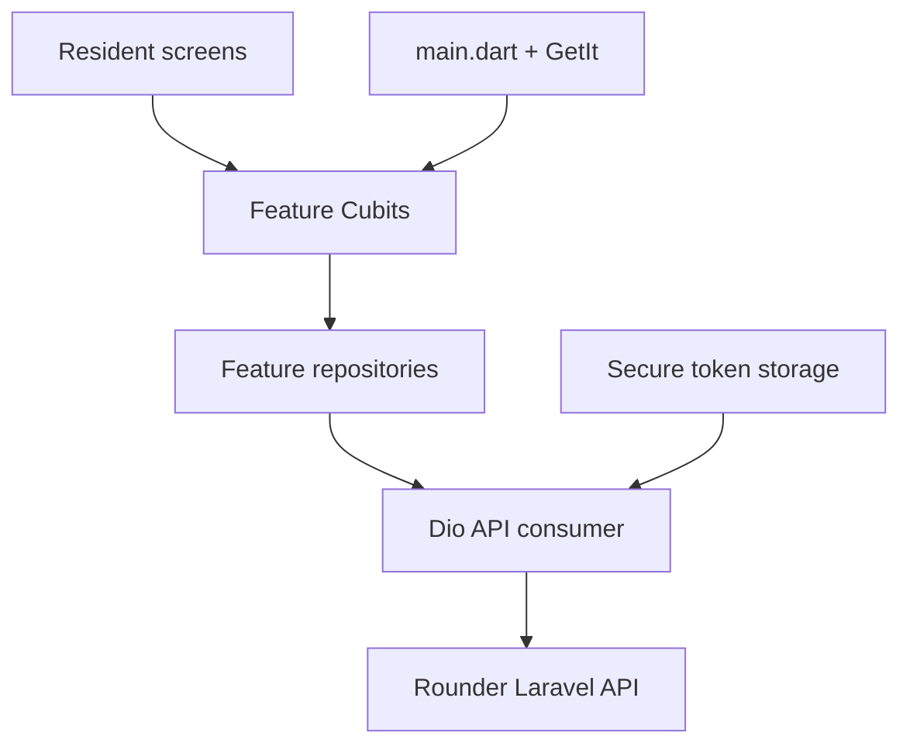

# Rounder Resident App · Implementation Guide

This guide documents the delivered app slice and its intended extension points. The source of truth for visual layout and remaining journeys is the Figma file's `02 - Resident App` page. QA/simulation boards are review aids rather than resident UI.

## 1. Architecture and request flow

- Presentation widgets render states and dispatch user actions.
- Cubits own screen state and call repositories; they do not build URLs or parse raw JSON.
- Repositories call `ApiConsumer` and map JSON into feature models.
- The shared Dio interceptor sends the current language and saved bearer token.
- `AuthCubit` restores the persisted token on launch. The API remains responsible for validating it.
- Set the API host with `--dart-define=API_BASE_URL=https://host/api/v1`.

## 2. File map

| Area | Key files | Responsibility |
|---|---|---|
| Bootstrap | `lib/main.dart`, `lib/service_initialize.dart`, `lib/app.dart` | EasyLocalization setup, GetIt, auth gate, global theme |
| Locale IDs | `lib/core/locale/app_locale_key.dart` | Stable IDs used by every visible translated label |
| Image IDs | `lib/core/images/app_images.dart` | Central asset paths; store approved exports in `assets/images/` |
| Theme | `lib/core/theme/app_theme.dart` | Rounder petrol, orange, sand, mint and shared Material theme |
| Network / DI | `lib/core/network/*`, `lib/core/services/services_locator.dart` | Dio, bearer token, locale headers and feature registrations |
| Sign-in | `lib/layout/global/features/auth/data/repo/auth_repo.dart`, `lib/layout/global/features/auth/presentation/cubit/auth_cubit.dart`, `lib/layout/global/features/auth/presentation/view/screen/login_screen.dart` | Registration, sign-in, encrypted token persistence and sign-out |
| Resident dashboard | `layout/resident/data/models/resident_dashboard.dart`, `data/repositories/resident_repository.dart`, `presentation/cubit/resident_dashboard_cubit.dart`, `presentation/screens/resident_home_screen.dart` | Live home balance, health, upcoming work and latest booking |
| Residence linking | `presentation/screens/link_home_screen.dart` | Link an account to a managed home via property code and unit |
| Service catalog | `data/models/service_option.dart`, `data/repositories/services_repository.dart`, `presentation/cubit/services_cubit.dart`, `presentation/screens/services_screen.dart` | Fetch translated services and submit a dated booking |
| Booking history | `data/models/booking_item.dart`, `data/repositories/bookings_repository.dart`, `presentation/cubit/bookings_cubit.dart`, `presentation/screens/bookings_screen.dart` | Read resident bookings and cancel eligible future requests |
| Locale files | `assets/i18n/ar.json`, `en.json`, `ur.json` | Arabic, English and Urdu display values |

Keep screen-specific widgets beside their screen or under a feature `widgets/` directory when they are reused. Keep image IDs in `AppImages` and text IDs in `AppLocaleKey`; do not add display copy directly to widgets.

## 3. Resident prototype paths

| Figma journey | Current app behavior | API |
|---|---|---|
| Welcome / create account / sign in | Implemented; language can be changed before sign-in | `POST /auth/register`, `POST /auth/login` |
| Connect residence | Implemented; property code + unit label; linked residence becomes primary | `POST /resident/homes/link` |
| Resident home overview | Implemented; pulls live values and supports pull-to-refresh | `GET /resident/dashboard` |
| Browse services | Implemented; translated service cards and database prices | `GET /resident/services` |
| Book a service | Implemented; selects a date and creates a booking | `POST /resident/bookings` |
| Track / review bookings | Initial list implemented; eligible pending/confirmed records can be cancelled | `GET /resident/bookings`, `POST /resident/bookings/{id}/cancel` |
| Community and events | Navigation shell exists; screen/API still needs implementation from Figma | — |
| Payments / invoices | Data model exists server-side; resident payment screen and payment-provider integration remain | — |
| Rewards | Not implemented yet | — |
| Profile / settings / notifications | Sign-out and locale selection exist; full profile/preferences/notifications screens remain | `GET /me` |
| Aftercare / ratings / cancellation reasons | Basic cancellation exists; the remaining feedback and reason-selection journey needs implementation | — |

Before implementing a Figma frame, map its entry point, success/empty/loading/error states, and API data contract here. Do not render internal QA frames as resident screens.

## 4. Localization and direction

- The app starts in Arabic and persists language selection through EasyLocalization.
- Supported tags: `ar`, `en`, `ur`. Flutter localization delegates set RTL for Arabic and Urdu.
- Use IDs such as `AppLocaleKey.bookService`; keep the identifier the same in all three JSON dictionaries.
- Values containing resident names should use interpolation, for example `hello` with the `name` argument.
- API requests carry `Accept-Language`; server-provided service/status text should be rendered as returned.

## 5. Build and verification

- Local setup: `flutter pub get`
- Static checks: `flutter analyze`
- Unit tests: `flutter test`
- Local API URL: `flutter run --dart-define=API_BASE_URL=https://your-api.example/api/v1`
- GitHub Actions creates the Android host and publishes `app-release.apk` as an artifact when the workflow succeeds.

## 6. Editing checklist

1. Add/modify a user-visible label in `AppLocaleKey` and all three locale JSON files.
2. Add network behavior to the feature repository and model, not the widget.
3. Add loading, success, empty and error states to its Cubit/screen.
4. Keep forms aligned with Laravel validation and show field errors without discarding entered values.
5. Add a test when behavior or API mapping changes.
6. Check the Figma page's intended flow and design tokens before changing spacing, color or navigation.
